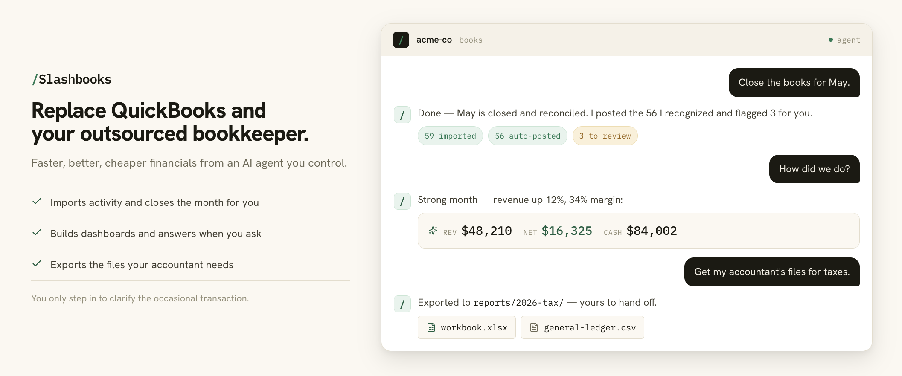

# Slashbooks

**Website: [slashbooks.org](https://slashbooks.org/)**

Bookkeeping for people who keep putting it off. Your AI agent keeps the
books current and ready for review, so you can see where you stand.

**Replace QuickBooks and your outsourced bookkeeper.** Slashbooks gives you
faster, better, cheaper financials from an AI agent you control. It runs in
Claude Cowork, Claude Code, Codex, and other agents. Use the `/books` skill or
just ask in plain English.

It does the tedious work: set up the books, pull in bank and card activity,
categorize the repeat transactions, close the month, answer your questions, and
export the files your accountant needs. You help clarify unfamiliar transactions,
missing documents, and accounting choices that need your judgment.

No bloated accounting app. No spreadsheet wrangling. Nothing new to learn.

> **Why I built this:** I was tired of paying for QuickBooks and an outsourced
> bookkeeper for books that were always behind, so I built a bookkeeper my AI
> agent runs and that I control.

Your books are local: a folder of files on your own computer, with a SQLite ledger
you own. Slashbooks works from QuickBooks exports and live bank/card feeds (via
BankSync) and exports the Excel/CSV files your accountant needs; it does not sync
back to QuickBooks or Google Sheets. Optionally, you and your accountant can share
the same books in a Slashbooks Cloud workspace; see
[Local books and Slashbooks Cloud](docs/cloud.md).

**[Install for Claude Cowork, Claude Code, or Codex →](#install)**

## Supported runtime

The CLI needs Python 3.11 or newer on Windows, macOS, or Linux. Windows uses
native file permissions and locks; WSL and administrator access are not required.
Install Python, restart the agent, and use the plugin normally. The agent uses
`scripts/books.cmd` from PowerShell or Command Prompt, or `scripts/books` from
Git Bash. Both launchers find an installed Python interpreter.

Keep credentials and company folders on a local drive that supports Windows
access-control lists, such as NTFS. Slashbooks checks private storage before
browser sign-in. It refuses files with permissions that allow other users,
and refuses junctions and symbolic links in protected transfer/migration paths.

## What You Can Do

- Keep cash books (the default), or accrual books that separate income and expenses from their payments. A cash company can turn accrual on later from a date and keep its cash history.
- Keep each company's books in one currency: USD by default, or the currency of its first bank, Stripe or QuickBooks import.
- Record tax facts for your preparer (tax method, fiscal year, prior return method, deposits) and export a tax-line trial balance.
- Record unpaid bills and customer invoices, then match payments without counting income or expenses twice. Keep overpayments and deposits as credits and apply them to invoices.
- Spread annual software or insurance costs across their service months, record customer prepayments as income when earned, and depreciate equipment straight-line.
- Accrue estimates that reverse themselves or are trued up to the actual bill, and write off uncollectable invoices.
- Record adjustments from payroll or tax provider reports and retain the supporting documents.
- Start accrual books from scratch, from a cash-basis company, or from QuickBooks.
- Keep the ledger in a local SQLite store you own, with Beancount-style exports
  when you need plain text.
- Connect Stripe, Mercury, and bank feeds, or have your agent build a connector for anything else.
- Schedule authorized bookkeeping preparation with current books ready for review; final close requires explicit authorization.
- Review unfamiliar transactions before they become trusted rules.
- Ask about recorded income, expenses, unpaid balances, overdue amounts, or what needs attention before close.
- Get financial statements, supporting schedules, charts, and accountant exports without clicking through an accounting app.
- Collect and validate the QuickBooks Online reports needed for a migration or backtest.
- Backtest against QuickBooks exports (prove the numbers match) before trusting a migration.
- Export the workbook and CSV files your accountant needs at tax time. Reconcile each bank account first; export needs a saved reconciliation.

For example, ask your agent:

> Record this contractor bill for July; we have not paid it yet.
>
> Spread this annual software payment across the months it covers.
>
> Match this customer receipt to what they owe us.
>
> Prepare July and tell me what still needs attention before we close.

The agent should explain the proposed result, the supporting document, whether a
payment is already recorded, and what balance will remain. You do not need to
choose internal record IDs or prepare accounting input files. See the
[accrual task guide](docs/accrual.md) for examples and supported limits, and
[accrual recipes](docs/accrual-recipes.md) for a tested request for each pattern.

## Status

Slashbooks is beta software. Review its output and use professional judgment for
accounting and tax decisions.

- **One ledger, a default view.** Each company keeps one ledger. Its basis (cash or
  accrual) is the default view for reports, answers and exports; cash is the default.
  `books report ... --basis cash|accrual` shows the other view for one command.
- **Accrual later.** A cash company can turn accrual on from a tracking start date
  (`books accrual enable`), list the invoices and bills still open on that date, and
  then change the default view (`books entity set-view`). Earlier periods stay cash,
  and published statements keep their basis. Accrual covers one company, for services
  and SaaS businesses; see [accrual books](docs/accrual.md).
- **One currency.** Each company keeps its books in one currency, USD unless the first
  import or a person sets another. There is no currency conversion and no
  multi-currency. Currencies with zero or three decimal places (JPY, KWD) are not
  supported yet; see [company currency](docs/company-currency.md).
- **People decide settings.** An agent can preview the currency, the default view,
  accrual tracking, the fiscal year and the tax settings. A person applies them; see
  [agent controls](docs/agent-controls.md).

Slashbooks is not tax, legal, accounting, payroll, inventory, or investment advice.
It doesn't replace professional review, and it isn't designed for businesses
that need payroll or tax calculations, inventory costing, complex revenue contracts,
or enterprise accounting controls. We're open to expanding what it covers; if you'd like to help,
see [CONTRIBUTING.md](CONTRIBUTING.md).

## Start Here

To use Slashbooks for a company, read:

- [How to do your books with Slashbooks](docs/doing-your-books.md)
- [Accounting philosophy](docs/philosophy.md)
- [For accountants](docs/for-accountants.md)
- [Accrual books, reports, and close](docs/accrual.md), including how to turn accrual on for a cash company
- [Accrual recipes: a tested request for each pattern](docs/accrual-recipes.md)
- [Supporting documents and request reference](docs/accrual-intake.md)
- [Tax handoff: source coverage, tax method view, and tax-preparer export](docs/tax-handoff.md)
- [Connectors](docs/connectors.md)
- [BankSync setup](docs/banksync.md)
- [CSV, QuickBooks, and file imports](docs/imports.md)
- [Company currency](docs/company-currency.md)
- [QuickBooks Online API reference sync and opening review](docs/quickbooks-sync.md)
- [Work events](docs/work-events.md)
- [Caller controls and person-only settings for connected agents](docs/agent-controls.md)
- [Financial statements: structure, cash flows, comparative periods](docs/statements.md)

The short version: after installing the plugin, create or choose a parent folder
for company books, such as `~/Documents/books`. Each company gets its own
subfolder inside that parent, such as `~/Documents/books/acme-co`. Do not use
the plugin source repo as the company books folder.

Open the parent folder in Claude Cowork, Claude Code, or Codex and say:

> I want to set up books for this company here.

The agent will ask onboarding questions, confirm the company subfolder, and
create the starter files there. Plugin upgrades should never overwrite company
books.

Want to explore before connecting real data? Open the parent books folder and
ask:

> Let's setup the books for the demo company.

The agent will show the onboarding questions with Northstar Metrics LLC's
fictional answers and ask whether you want to use them as-is or change anything
first. Then it creates the most recent full calendar year plus current
year-to-date sample business activity and a few transactions to review, so you
can try the normal Slashbooks workflow without connecting real accounts.

## Install

Pick the app you prefer. Install the plugin once, then use it from a
separate books parent such as `~/Documents/books/`, with one subfolder per
company.

### Claude Cowork

Best for most people. Cowork gives you a guided workspace for setup, review, and
monthly bookkeeping without living in a terminal.

1. Open Claude and go to **Cowork**.
2. Open **Customize**.
3. Go to **Plugins**.
4. Under **Personal plugins**, click **+**.
5. Choose **Add marketplace**. If your UI first shows **Create plugin**, choose
   that, then **Add marketplace**.
6. Paste:

   ```text
   https://github.com/giltotherescue/slashbooks
   ```

7. Click **Sync**.
8. Install or enable `/books` from the synced marketplace.

### Claude Code

Use this if you prefer Claude in a terminal.

```sh
/plugin marketplace add https://github.com/giltotherescue/slashbooks
/plugin install slashbooks@slashbooks
```

### Codex

Use this if you prefer OpenAI Codex for local coding-agent work.

```sh
codex plugin marketplace add https://github.com/giltotherescue/slashbooks
```

Then restart Codex if needed, open the plugin directory, choose the Slashbooks
marketplace, and install the plugin.

### Command line and development

`pip` installs the `books` command line. The plugin, installed above, gives your
agent the workflows (`/books` and the skills) that call it. The command line has no
runtime dependencies; the Excel workbook export needs the optional extra
`pip install -e '.[xlsx]'` (or `pip install 'agent-books[xlsx]'`). Without it,
export writes the same data as CSV files.

```sh
git clone https://github.com/giltotherescue/slashbooks slashbooks
cd slashbooks
pip install -e '.[xlsx]'
python3 -m unittest discover -s tests
```

The public command is `books`.

To try accrual books locally in a new company folder:

```sh
books entity init ~/Documents/books/acme --name "Acme" --basis accrual --business-type saas --cutover-date 2026-01-01
books accrual accounts --entity ~/Documents/books/acme --format text
books accrual schema
```

[Accrual recipes](docs/accrual-recipes.md) walks through a request for each pattern,
from an unpaid bill to the month-end close.

To try the current checkout without installing the plugin through an app
marketplace:

```sh
books demo init ~/Documents/books/northstar-demo
cd ~/Documents/books/northstar-demo
books queue list --entity .
```

`books demo init` prints the generated period. Use those dates for local report
commands.

To test the current checkout through an agent before publishing a release, add
the local marketplace.

Claude Code:

```text
/plugin marketplace add /path/to/slashbooks
/plugin install slashbooks@slashbooks
```

Codex:

```sh
codex plugin marketplace add /path/to/slashbooks
codex -C ~/Documents/books
```

Then install/enable `slashbooks` from the local Slashbooks marketplace if the app
prompts for it. To test the demo through the agent, start in the books parent
folder and say:

> Let's setup the books for the demo company.

If the local marketplace is hidden in the Codex app, open the plugin detail page
directly:

```sh
SLASHBOOKS_REPO=/path/to/slashbooks
MARKETPLACE_URL=$(python3 - <<'PY'
import os
from urllib.parse import quote
print(quote(os.path.join(os.environ["SLASHBOOKS_REPO"], ".agents/plugins/marketplace.json"), safe=""))
PY
)
open "codex://plugins/slashbooks?marketplacePath=${MARKETPLACE_URL}"
```

## Workflows

Start with `/books` or natural language like “do my books here.” That router
checks whether the current directory already has an entity and sends the agent to
the right workflow.

```text
/books
├── /books-onboard      set up a company, sources, and opening balances
├── /books-qbo-fetch    collect the required QuickBooks Online reports
├── /books-backtest     compare against QuickBooks exports before trusting it
├── /books-checkup      review setup, mappings, and close readiness
├── /books-close        import activity, review unknowns, and finalize a period
├── /books-dashboard    create dashboards, snapshots, and formatted reports
├── /books-review       resume or work through queued transactions
├── /books-ask          answer questions from the ledger
├── /books-feedback     draft an implementation-ready Slashbooks feedback handoff
└── /books-export       export the workbook and CSV files accountants need
```

The agent workflows call the `books` CLI and don't compute financial totals
themselves. Any assistant with CLI/API access can discover `books accrual schema`
and use the same contracts; plugin skills are optional guidance. Persistent or
scheduled assistants need access to the selected books and explicit delegated
authority. Scheduling does not authorize a close, publication, or money movement.
See [source-neutral intake and authority](docs/accrual-intake.md).

## Company Data

Each company directory contains its own books and generated state:

```text
acme-co/
├── entity.json
├── trust-policy.json
├── ledger.sqlite
├── staging/
├── review-queue/
├── learned-context/
├── ingestion/
└── reports/
```

By default, Slashbooks stores company data locally in the company directory you
choose, and the plugin does not host your books. Optionally, during onboarding you can
connect a folder to Slashbooks Cloud, a hosted service where you and your
accountant share the same books. Cloud is free during the beta, with at least
30 days' notice before any charge. The plugin, commands and accounting rules are the
same in both cases. See [Local books and Slashbooks Cloud](docs/cloud.md).

Context and preferences live there too:

- `business-profile.md` keeps human-readable business background and accountant
  context.
- `entity.json` stores structured settings such as legal structure, business
  type, dates, mappings, and jurisdiction context.
- `trust-policy.json` controls how conservative Slashbooks is before auto-posting
  repeat transactions.
- `ledger.sqlite` stores the books, account catalog, and tamper-evident audit
  history.
- `learned-context/` records what Slashbooks learns from owner review decisions,
  such as usual categories for counterparties.
- `review-queue/` holds transactions waiting for owner judgment.

Credentials should live in `.env`, your OS credential store, or another local
ignored secrets file. The `books` command reads `./.env` from the current company
directory. Do not commit API keys, bank exports, QuickBooks exports, company
ledgers, generated reports, or entity directories.

When you need a Beancount file for inspection or another tool, generate it from
`ledger.sqlite`; Beancount is an export/projection format, not the canonical
account catalog.

## Contributing

See [CONTRIBUTING.md](CONTRIBUTING.md). Do not commit API keys, bank exports,
QuickBooks exports, company ledgers, generated reports, or entity directories.

## Support

For bugs, feature requests, and questions, open a GitHub issue.

## License

Apache-2.0. See [LICENSE](LICENSE).

Project names and logos are not licensed under Apache-2.0. See
[TRADEMARKS.md](TRADEMARKS.md).
